<p align="center">
  <a href="LICENSE"></a>&nbsp;
  <a href="backend/requirements.txt"></a>&nbsp;
  <a href="https://fastapi.tiangolo.com/"></a>&nbsp;
  <a href="https://react.dev/"></a>&nbsp;
  <a href="https://vite.dev/"></a>
</p>

# EY CX Studio

EY CX Studio is an internal platform for running customer experience consulting engagements. It
provides five analysis modules that a consultant can use independently, and a project layer that
groups them so the work done for one client is tracked in one place.

The interface and the generated deliverables are bilingual (English and French). Access is
invite only: every route requires a signed in account, apart from the passwordless link a
consultant sends to a client so that the client can answer an assessment directly.

## Product walkthrough

Explore the [maturity assessment](#maturity-assessment-in-action), then see how
[projects, research, and customer feedback](#from-evidence-to-an-issue-log) support the engagement.
Expand each section for screenshots of the workflow and its deliverables.

<details>
<summary><strong>Meet CX Studio: one workspace for the engagement</strong></summary>

The studio brings the analysis modules into a shared workspace, with English and French
interface options.

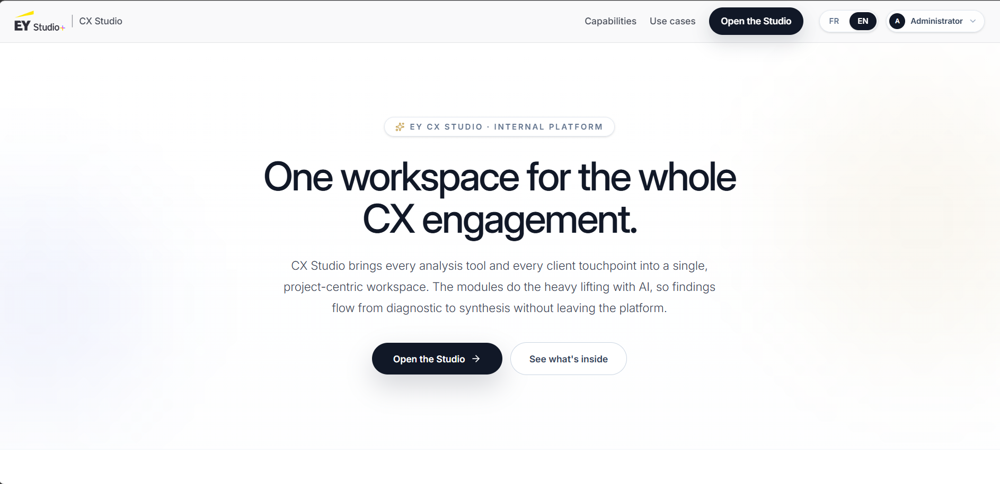

The pipeline connects maturity assessment, interviews, social listening, desk research, and
the issue log. Consultants can use a module independently or group its results within a project.

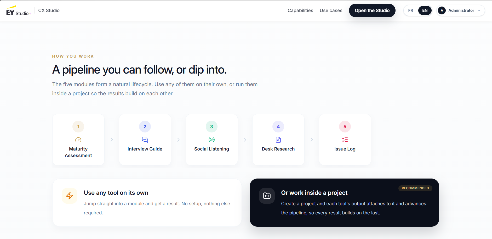

</details>

### Maturity assessment in action

From a guided conversation to a report a consultant can act on: the assessment brings together
CX maturity scores, capability gaps, sector benchmarks, and a phased improvement plan.

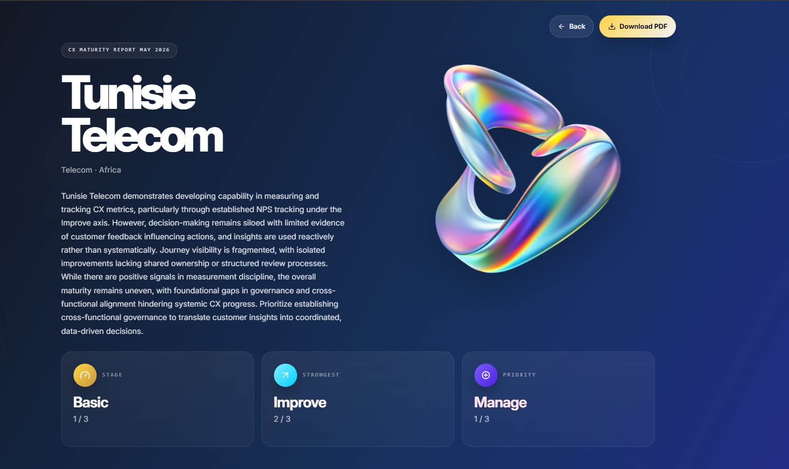

The report puts the overall maturity stage, strongest axis, and priority area beside an executive
summary, with a PDF download available for sharing the deliverable.

<details>
<summary><strong>Client journey: introduce the assessment and capture business context</strong></summary>

The client-facing landing page introduces ORION and invites the client to begin a guided
conversation about how their organisation manages, measures, and improves customer experience.

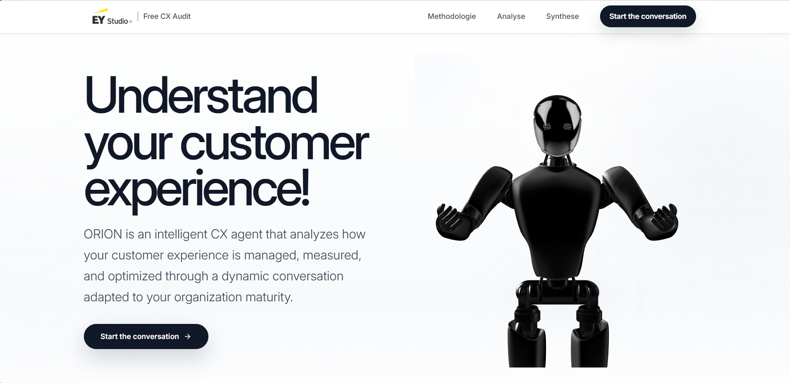

Company name, sector, size, and region establish the context for the questions and benchmark
examples before the assessment starts.

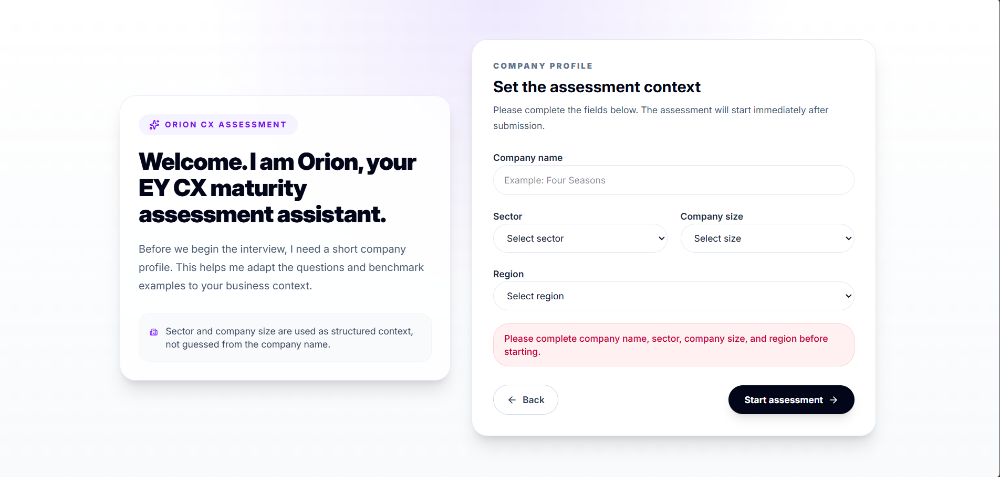

</details>

<details>
<summary><strong>Report walkthrough: turn maturity findings into priorities</strong></summary>

**Locate the maturity stage.** The report positions the assessment on the Basic, Established,
and Advanced scale.

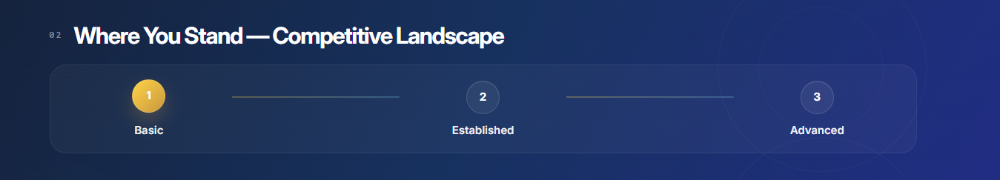

**Explain the gaps.** Manage, Analyze, and Improve scores are paired with a closer look at
capabilities that are working and those where evidence is missing.

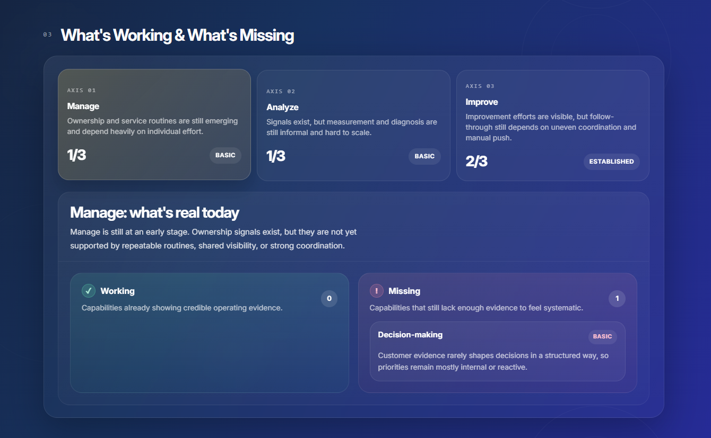

**Bring in external reference points.** Sector leader examples include source links so readers
can explore the evidence behind the benchmark.

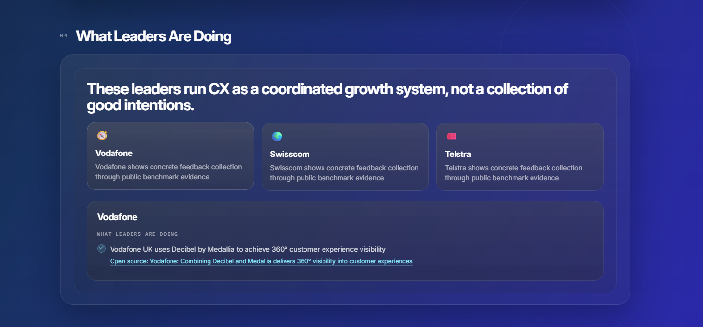

**Sequence the next steps.** Quick wins are organised from week one through months three and
four, translating the diagnosis into a phased action plan.

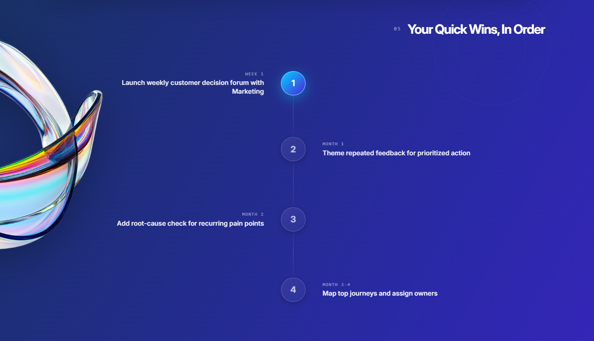

**Connect findings to follow-up.** The closing section presents relevant consulting services
and options to request the report or book a discussion.

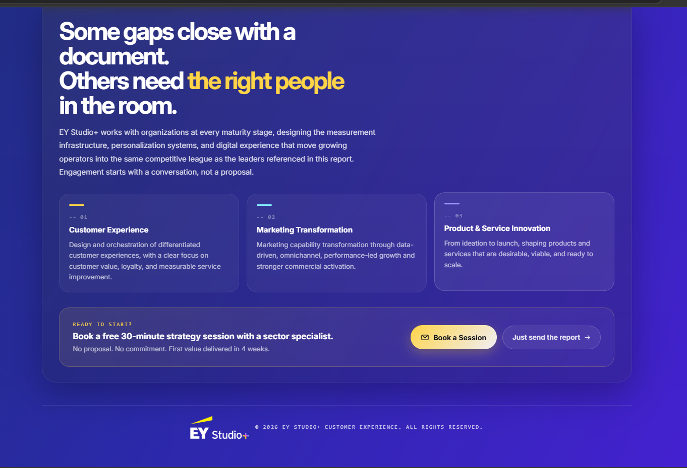

</details>

<details>
<summary><strong>Admin analytics: explore assessments across engagements</strong></summary>

The admin view maps assessments by region and provides filters for date, sector, company size,
and region, helping consultants explore the assessment portfolio.

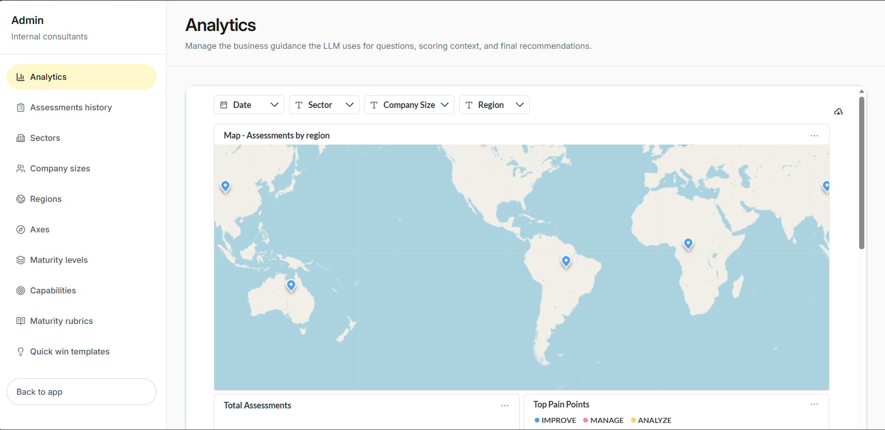

</details>

### From evidence to an issue log

<details>
<summary><strong>Projects: track progress and keep results together</strong></summary>

The project overview combines pipeline progress, team access, and attached results. Consultants
can reopen completed assessments and interview guides from the same engagement workspace.

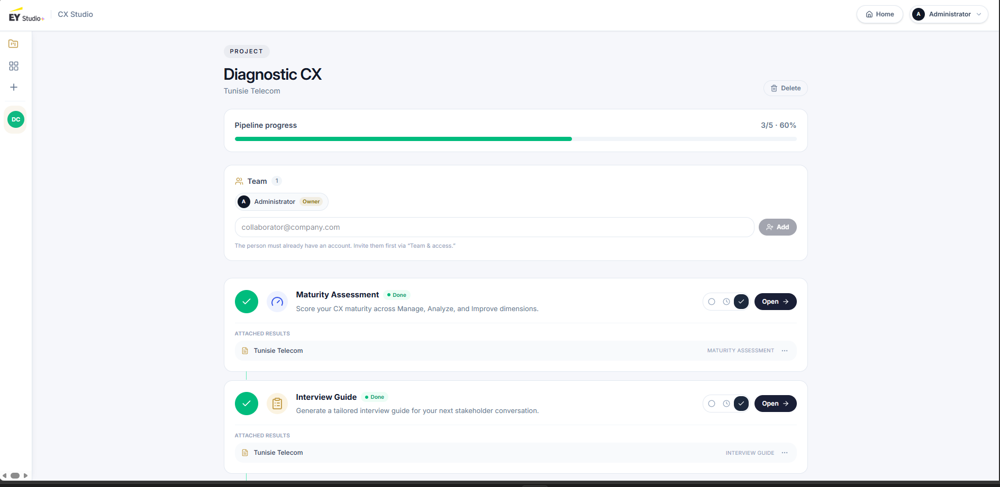

</details>

<details>
<summary><strong>Desk research: turn documents into findings and explore the evidence</strong></summary>

Research sessions keep uploaded documents alongside the executive report controls and research
assistant. The workspace lets consultants specify analysis goals before generating a report
and ask questions about the session's documents.

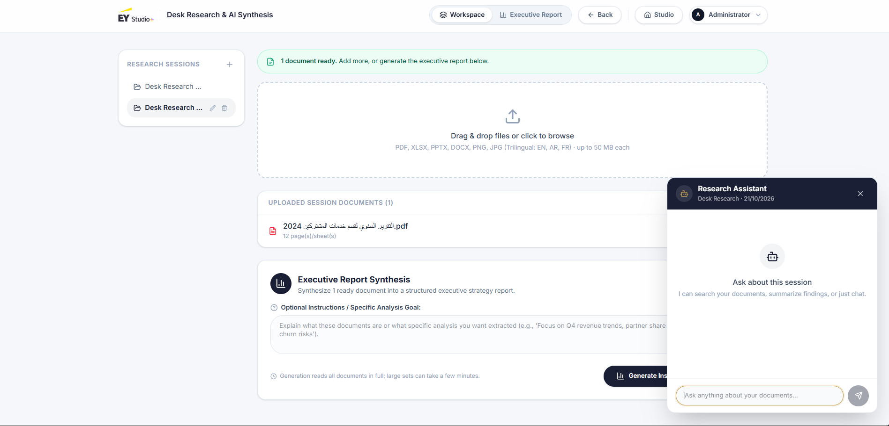

The executive report summarises findings and highlights problems, with document and page
references alongside the analysis. The research assistant lets consultants explore the report
in conversation while keeping the findings in view.

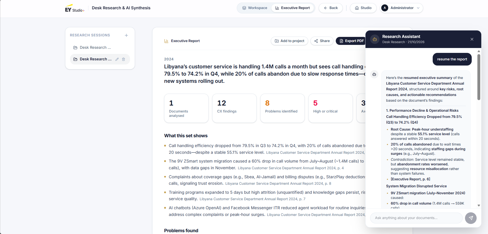

</details>

<details>
<summary><strong>Social listening: connect measured feedback to customer pain points</strong></summary>

The report brings sentiment, ratings, review volumes, and channel coverage together. Visible
sample counts distinguish the comments classified for sentiment from the wider set of collected
reviews, while PDF and Excel exports support sharing the results.

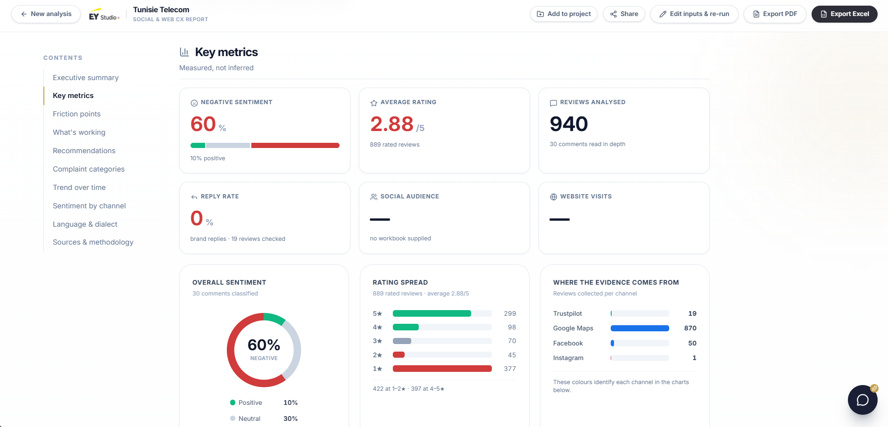

Friction points are ranked by evidence volume and paired with review excerpts and source links,
so consultants can examine the customer feedback behind each theme.

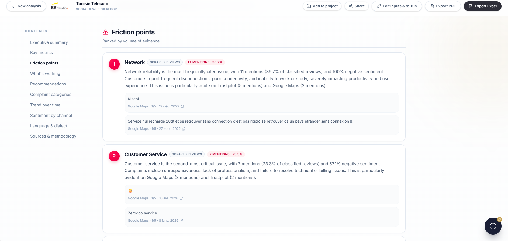

</details>

<details>
<summary><strong>Issue log: carry findings into a working spreadsheet</strong></summary>

Consultants select the assessments, interviews, social listening results, and desk research
analyses to consolidate, with an optional focus to guide the issue log.

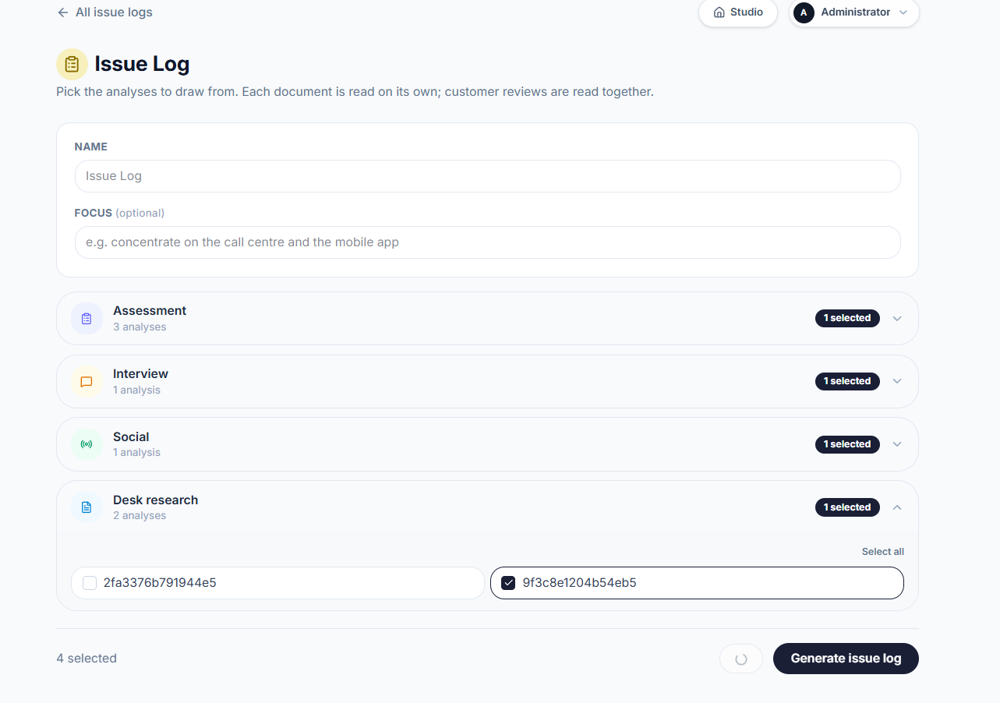

The spreadsheet view organises findings, investigation details, strategic dimensions, issue
subcategories, and sources into a filterable table for consultant review and follow-up.

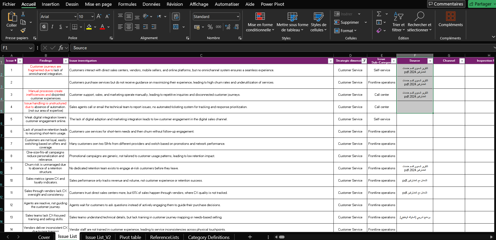

</details>

## Modules

| Module | Purpose |
|---|---|
| Maturity assessment | A guided conversation that scores customer experience maturity on the Manage, Analyze and Improve axes against the framework's rubrics, then produces a report with quick wins, a recommendation timeline, and a benchmark of sector leaders built from web evidence. |
| Interview guide | Generates a stakeholder interview guide, either from a completed assessment or from scratch. The guide is editable, answers are captured against each question, and an assistant cross references those answers with the assessment to flag disagreements. |
| Desk research | Accepts client documents (PDF, DOCX, PPTX, XLSX, images) and produces a structured report. A chatbot answers questions over both the documents and the report it generated. |
| Social listening | Collects public reviews and posts, classifies each one for sentiment, theme and complaint category, then reports on the aggregate. Every figure in the report is computed in Python; the model writes only the prose around it. |
| Issue log | Consolidates the findings of the other modules into one prioritised list of issues, with the conflicts between sources made explicit, and exports it as a spreadsheet. |

### Projects

A project is not a sixth module. It is a layer over the five: it holds the pipeline for one client
engagement, results attach to it as each module produces them, and members can be added so a
colleague sees the same work. The modules do not depend on it and each runs the same way with or
without a project open.

## Architecture

The backend is a FastAPI application over PostgreSQL, organised by feature under
`backend/app/services/`. Each feature owns its services; shared concerns (the language model
gateway, retrieval, storage, authentication) sit beside them and are used by all.

Two decisions are worth stating up front because they shape the rest:

**Every language model call goes through one gateway** (`app/services/llm/core/gateway.py`). That
is what applies the retry policy and what records usage into the `llm_calls` table, so a feature
that built its own HTTP request would be invisible to cost reporting.

**Numbers are computed in Python, never by a model.** Reports pass computed statistics into the
prompt and ask the model to explain them. This is why a report is reproducible across runs.

The frontend is React 19 with TypeScript, Vite and Tailwind CSS v4. It is organised the same way:
`src/features/` holds one folder per module, each behind an `index.ts` that names the single
component the rest of the application may import. `src/components/ui/` holds only what more than
one module uses.

## Repository layout

```
backend/
  app/
    api/routes/        HTTP endpoints, grouped by feature
    services/          the features, plus shared llm/, rag/, auth/, storage
    repositories/      database access
    db/models/         SQLAlchemy mappings
    schemas/           request and response shapes
  migrations/          numbered SQL, applied in order by seed.py
  tests/
frontend/
  src/
    features/          one folder per module and for projects, each with an index.ts
    components/ui/     shared components only
    lib/               API client, shared hooks, copy tables, brand palette
docs/
  architecture/        one document per feature
```

## Running it locally

### Prerequisites

- Python 3.12
- Node.js 20
- PostgreSQL 13 or later, running locally

Note that `docker-compose.yml` in the repository root does not start the application database. It
runs Metabase and a separate PostgreSQL instance for it, used for the analytics dashboards. The
application database has to be created separately.

### 1. Database

Create an empty database, for example:

```bash
createdb cx_assessment
```

### 2. Backend

```bash
cd backend
python -m venv .venv
# Windows:      .venv\Scripts\Activate.ps1
# macOS, Linux: source .venv/bin/activate
pip install -r requirements.txt

cp .env.example .env
```

Edit `.env` and set `DATABASE_URL`. It is the only variable the application refuses to start
without.

`JWT_SECRET` is optional while `APP_ENV` is `development`, where the application falls back to a
known insecure value and says so. It is required for any other value of `APP_ENV`, and startup
fails without it.

Apply the schema and the reference data. `seed.py` runs the numbered SQL migrations in order and
records which have already been applied, so it is safe to run again:

```bash
python seed.py
```

Create the first account. There is no open sign up, so this is how anyone gets in:

```bash
ADMIN_EMAIL=you@example.com ADMIN_PASSWORD='a strong passphrase' python -m app.scripts.create_admin
```

Start the API:

```bash
python -m uvicorn app.main:app --host 127.0.0.1 --port 8000 --reload
```

### 3. Frontend

```bash
cd ../frontend
npm install
npm run dev
```

Open `http://localhost:5173` and sign in with the account created above. From the services page you
can open a module directly or create a project first.

### First run notes

Retrieval uses a local embedding model (`multilingual-e5-small`) that downloads on first use, about
470 MB. If `sentence-transformers` is not installed the chatbots fall back to keyword retrieval
automatically, so the application still runs.

Document extraction downloads model weights on first use as well. The first upload is therefore
noticeably slower than later ones.

## Configuration

All backend configuration is read from environment variables. `backend/.env.example` documents
every one of them.

| Variable | Required | Purpose |
|---|---|---|
| `DATABASE_URL` | Yes | PostgreSQL connection string |
| `JWT_SECRET` | Outside development | Signs access tokens. A development fallback exists; any other environment requires it |
| `MISTRAL_API_KEY` | For anything generative | The main chat model. Without it the application starts and the modules load, but every feature that writes text logs an error and returns nothing |
| `LANGSEARCH_API_KEY` | For benchmarks | Web search behind the competitor benchmark |
| `APIFY_API_TOKEN` | For social listening | Review and post collection |
| `GEMINI_API_KEYS` | For images | Vision captioning of images in uploaded documents |
| `OPENROUTER_API_KEY` | Optional | Fallback provider when Gemini is unavailable |
| `SMTP_*` | For invites | Sending invitations and client assessment links |

The frontend reads `VITE_API_BASE_URL`, which defaults to the local API.

Runtime data written by the application (`scraped_data/`, `desk_research_data/`, `rag_data/`,
`interview_chat_data/`) is ignored by git, as is `.env`.

## Tests and checks

Backend:

```bash
cd backend
python -m pytest
```

There are 564 tests and they pass. They run against a neutralised configuration:
`tests/conftest.py` replaces the environment before any application module is imported and fails
the run outright if the configuration still points at anything resembling production.

Frontend:

```bash
cd frontend
npm run verify     # type check, brand palette check, production build
npm run lint
```

`npm run check:brand`, included in `verify`, asserts that the brand colours defined in
`src/index.css` match those in `src/lib/brand.ts`. The palette is written in both places because
CSS custom properties cannot be read from JavaScript without a DOM, and the check is what keeps
the two from drifting.

## Deployment

The `Dockerfile` builds both halves into one image: the frontend is built with Node and its
output is copied into the Python image, which serves the API and the built frontend from the same
process. The container listens on `$PORT`, defaulting to 8000.

```bash
docker build -t cx-studio .
docker run --env-file deploy.env -p 8000:8000 cx-studio
```

One deployment detail is easy to get wrong: `docker run --env-file` is not a shell. It does not
strip quotes or trailing comments, so a value written as `MISTRAL_API_KEY="abc"` is sent with the
quotation marks included and every model call fails authentication. Values in the env file must be
unquoted.

## Documentation

`DEEPDIVE.md` is the reference for the codebase itself. It covers each feature in turn: what it
does, which files implement it, how a request travels through them, and where the decisions that
are not obvious from the code are recorded. Start there when you need to change something rather
than run it.

`docs/architecture/` holds one document per feature, written while each was built, covering the
engineering decisions in more depth than this file.


